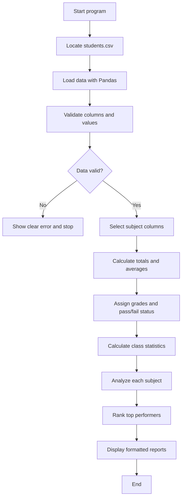

# Student Performance Analytics System

Reads `students.csv` (20 records), computes each student's total, average, grade, and pass/fail status, then prints class stats, subject stats, and the top 5 performers. Built with Python, Pandas, and NumPy for a Python with AI course assignment.

## Dataset

`students.csv` — columns `student_id, name, department, python_marks, mathematics_marks, statistics_marks, attendance`. Marks on a 0–100 scale, attendance 0–100 (reported separately, does not affect pass/fail).

## Rules

- Grades: A+ (90+), A (80+), B (70+), C (60+), D (50+), F (below 50).
- Pass = at least 40 in **every** subject. One subject below 40 means fail.

## How to run

```bash
python -m pip install -r requirements.txt
python main.py
```

Requires Python 3.12+.

## Files

- `main.py` — loads the CSV, runs the checks and calculations, prints the report.
- `functions.py` — the calculation and reporting functions (`load_data`, `validate_data`, grade/pass assignment, class and subject analysis, top performers).
- `students.csv` — the 20-record dataset.
- `requirements.txt` — `pandas` and `numpy` pins.
- `Project_Documentation.md` — objective, implementation, real output, and learnings.
- `screenshots/analysis-output.png` — capture of an actual run.

## Workflow



## Output

```
STUDENT PERFORMANCE ANALYTICS
--------------------------------
Total students: 20
Class average: 72.82
Highest average: 96.67 | Lowest average: 41.67
Students passed: 17 | Students failed: 3
Pass percentage: 85.00%

TOP PERFORMERS (top 5, ties included)
Student ID | Name | Average | Grade
STU008 | Ishita Nair | 96.67 | A+
...

SUBJECT SUMMARY
Subject | Average | Highest | Lowest | Passed
python_marks | 71.35 | 98 | 38 | 19
...
```

Full output and screenshot under `screenshots/`.
